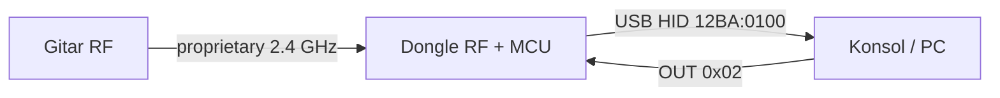

# Dongle yapımı veya kopyalama
_Exported on 10/9/2026 at 17:40:01 GMT+3 from Cursor (3.15.6)_

---

**User**

Şu şekilde donglelarım var gitar bateri için dalan. Bende gitar bateri falan 2 tane var hep donglları yok, kardeşime hediye edeceğim bazılarını ama dongle olamdığını için edemiyorum. İnternetten de gitar bateri parasına satıyorlar onlara da para vermek istemiyorum Chatgpt ile konuştuğumda dongle yapabilriiz demişti. Sen ne diyorsun bu dongleardan yapabilir miyiz veya kopyalayabilir miyiz?

---

**Cursor**

Fotoğraflardaki dongle’ları netleştirip, klonlama mı yoksa pratik alternatif mi daha gerçekçi ona bakıyorum.

Kısa cevap: **Aynı dongle’ı birebir kopyalamak pratikte yok.** ChatGPT burada fazla iyimser konuşmuş.

Fotoğraflardaki iki tip var:

1. **Küçük USB (Guitar Hero Live)** — Model `96142806`
2. **Kablolu kutu (GH5 / Band Hero, PS2–PS3)** — Model `95893.806`

Bunlar Bluetooth değil; Activision’ın **özel 2.4 GHz** protokolü. Arduino / ESP32 ile “dongle’ı klonlayalım” diye hazır, çalışan bir çözüm yok. RF protokolünü reverse engineer etmek ayrı, profesyonel seviye iş.

## Ne yapılabilir?

Asıl çözüm dongle kopyalamak değil, **enstrümanı kablolu USB yapmak**:

| Yol | Ne işe yarar | Zorluk |
|-----|--------------|--------|
| **Santroller + Raspberry Pi Pico** | Gitari / bateriyi açıp butonları Pico’ya bağlamak → Clone Hero vb. için USB kontrolcü | Orta; lehim + açma |
| **Orijinal dongle bulmak** | Kablosuz kalmak | Pahalı; model eşleşmeli |
| **Bozuk set + dongle almak** | Senin sağlam gitarına takmak | Bazen dongle’dan ucuz |

Santroller’ın USB Host özelliği **yalnızca kablolu** kontrolcülerle çalışır. Kablosuz-only gitarı dongle’sız Pico’ya takıp kullanamazsın; içeriden kablolama gerekir.

## Kritik uyarı

Dongle’lar **birbirinin yerine geçmez**:

- GH Live dongle ≠ eski GH5/Band Hero receiver  
- GH5 receiver (`95893.806`) ≠ World Tour / Les Paul receiver  
- Bateri receiver’ı ≠ gitar receiver’ı  

Yani elindeki dongle’lar, kardeşine vereceğin her enstrümanla otomatik uyumlu olmayabilir.

## Sonuç

- **Dongle klonu:** Hayır, gerçekçi değil.  
- **Gitarı / bateriyi Pico ile USB’ye çevirmek:** Evet, toplulukta standart yol bu.  
- **Hedef:** Clone Hero / PC ise bu yeterli. Orijinal konsol oyunu + kablosuz istiyorsan yine doğru model orijinal dongle gerekir.

İstersen bir sonraki adımda: hangi gitar/bateri modellerin var, hedef PC mi konsol mu — ona göre **Pico + Santroller** için net parça listesi ve kablolama planı çıkarırım.

---

**User**

blueetotholacak şekilde yine aynı kablosuz tapamaz mıyız bir şekilde

---

**Cursor**

Kabl

osuz kalıp Bluetooth ile kullanmanın gerçekten mümkün olup olmadığını araştırıyorum.


---

**User**

Evet, bu çıktı çok işimize yaradı. Büyük dongle'ın USB tarafının iskeleti artık neredeyse tamamen belli.
Elimizde şu var:
VID/PID       = 12BA:0100
USB           = Full Speed
HID           = 1.10
Interface     = 1
IN endpoint   = 0x81, Interrupt, 64 byte, 10 ms
OUT endpoint  = 0x02, Interrupt, 64 byte, 10 ms
Report Desc.  = 137 byte
Serial        = yok

Özellikle OUT endpoint olması önemli. Yani sadece gitar → PC yönünde veri gelmiyor; host da dongle'a veri gönderebiliyor. Pairing/LED/başlatma gibi işlemlerde bunun rolü olabilir.
Şu anda tek eksik kritik parça şu:
wDescriptorLength = 0x0089 = 137 bytes

Error reading descriptor

USBTreeView Windows API kısıtlaması yüzünden HID Report Descriptor'ı okuyamamış. Sorun değil.
Şimdi ham HID verisini okuyalım
Bence önce descriptor'la uğraşmak yerine gitarın gönderdiği gerçek reportları görelim. Python ile çok kolay.
PowerShell:
py -m pip install hidapi

Sonra gh_test.py diye dosya oluştur:
import hidimport timeVID = 0x12BAPID = 0x0100print("Guitar Hero dongle aranıyor...")devices = hid.enumerate(VID, PID)for d in devices:    print("Bulundu:")    print(d)if not devices:    raise SystemExit("Dongle bulunamadı.")device = hid.device()device.open(VID, PID)device.set_nonblocking(True)print("\nDongle açıldı.")print("Gitarı bağla ve tuşlara bas...\n")last = Nonewhile True:    data = device.read(64)    if data and data != last:        print(            " ".join(f"{b:02X}" for b in data)        )        last = data    time.sleep(0.005)


Çalıştır:
py gh_test.py

Gitarı dongle'a eşleştir.
Sonra hiçbir şeye basmadan bekle ve sırayla sadece:
Green → Red → Yellow → Blue → Orange → Strum Up → Strum Down → Whammy
yap.
Program yalnızca report değiştiğinde hexadecimal çıktıyı basacak. Örneğin şöyle şeyler görebiliriz:
00 00 00 00 80 80 80 ...
00 10 00 00 80 80 80 ...
00 20 00 00 80 80 80 ...

Bunları bana hangi hareketi yaptığını yazarak gönder:
BOŞ:
...

GREEN:
...

RED:
...

STRUM UP:
...

WHAMMY MIN:
...

WHAMMY MAX:
...

Böylece gitarın HID report formatını byte byte çıkarmaya başlayabiliriz.
Sonrasında ikinci aşama daha ilginç: aynı girdilerin gitar → 2.4 GHz → dongle tarafında nasıl kodlandığını çözmek. Replacement dongle yapmanın esas anahtarı orası.  chat gpt böylediyor sen farklı diyon ?

---

**Cursor**

USB katmanındaki bulgularınız doğru yönde; ChatGPT ile benim önceki uyarımın nerede örtüştüğünü netleştiriyorum.


**Farklı demiyorum — aynı işin farklı katmanlarından konuşuyoruz.** ChatGPT’nin önerdiği HID yakalama, dongle klonlama / emülasyon yolunda **doğru ve mantıklı birinci adım**. Benim “kolay kopyalanmaz” dediğim kısım, bu adımın **tek başına yetmemesi**; asıl zorluğun çoğu zaman **USB değil, 2.4 GHz tarafı**.

## İki katman



| Katman | Sizde ne var? | Ne işe yarar? |
|--------|----------------|---------------|
| **USB (host’un gördüğü)** | VID/PID, IN/OUT 64 byte, ~137 byte report descriptor | PC/konsol “dongle bu” der; tuşlar HID report olarak gelir |
| **RF (gitar ↔ dongle)** | Henüz yok | Eşleşme, kanal, şifreleme/CRC, paket formatı — **dongle olmadan gitar konuşmaz** |

`OUT endpoint` gerçekten önemli: eşitleme, LED, “pairing modu”, bazen periyodik poll — bunlar **host → dongle** komutları olabilir; dongle da bunları RF’ye çevirir. Önce IN report’ları toplamak yine doğru; sonra OUT’a bilinçli yazma denemeleri (dikkatli, log tutarak) ikinci tur olur.

## ChatGPT ile ben nerede aynıyız?

- **Önce gerçek HID report’ları** — descriptor olmadan bile tuş haritasını çıkarabilirsiniz; `gh_test.py` tam bu iş için.
- **137 byte descriptor** — Windows’ta USBTreeView bazen takılır; alternatif: Linux `lsusb -v`, Wireshark + USBPcap, veya libusb/pyusb (sürücüyü geçici ayırarak). Descriptor, report boyutlarını resmi olarak doğrular; pratikte sizin etiketli capture often yeterli.

## Nerede “temkinli” kaldım?

Replacement dongle = **hem RF protokolü hem USB gadget (12BA:0100 + aynı HID davranışı)**. Pico/ESP32 ile USB tarafı yapılabilir; **gitarın dinlediği RF’yi taklit etmek** aylar sürebilecek RE (FCC iç foto, logic analyzer, SDR, paket yakalama). ChatGPT’nin “ikinci aşama daha ilginç” dediği yer tam burası — ve evet, **anahtar orası**.

Yani: ChatGPT “yapılabilir bir proje” diyor → **evet, RE projesi olarak**. Ben “market dongle’ı Arduino ile kopyala” demedim → **hayır, hazır değil**.

## `gh_test.py` ile pratik notlar

Projede zaten `gh_test.py` var; akış doğru. Küçük iyileştirmeler:

1. **Aynı report tekrar basınca** `last` yüzünden basılmaz — strum gibi kısa pulse’lar kaçabilir; değişim yerine “her okuma + timestamp” veya edge sayacı daha iyi.
2. **Report ID**: Windows `hidapi` bazen ilk byte’ı report ID sayar; tüm 64 byte’ı göndermeniz doğru; not edin `00` ile mi başlıyor.
3. Log formatı: ChatGPT’nin `GREEN: ...` şablonu mükemmel — bunları bir `captures.txt`’e yapıştırırsanız byte map çıkarırız.

Örnek beklediğiniz tür (gerçek değerler sizden gelecek):

```
BOŞ:     00 00 00 00 ...
GREEN:   ?? ?? ?? ?? ...   (hangi bit/byte değiştiyse)
```

## Üç olası hedef (hangisini istediğinize göre yol değişir)

1. **Sadece PC / Clone Hero** — RF’yi çözmek şart değil; gitarı Santroller ile kablolu USB yapmak hâlâ en kısa yol.
2. **USB dongle emülatörü (Pico)** — Gitar **orijinal dongle’a** bağlıyken USB’yi dinlerseniz sadece protokolü **kopyalarsınız**; eksik dongle sorununu çözmez.
3. **Tam replacement dongle (projenizin adı)** — HID + OUT komutları + **2.4 GHz stack**; ChatGPT’nin 2. aşaması; sizin HID capture’ı buna zemin hazırlıyor.

---

**Özet:** ChatGPT’nin planına katılıyorum; ben sadece “descriptor + HID = bitti” değil, **RF olmadan fiziksel replacement bitmez** diye uyarıyordum. Sıradaki en iyi adım: dongle takılı, gitar eşli, `gh_test.py` çıktısını etiketli gönderin — birlikte report haritasını çıkarırız. İstersen bir sonraki mesajda `gh_test.py`’ye **etiketli kayıt modu** (Enter’a basınca “GREEN” yazıp son report’u dosyaya yazan) ekleyebilirim; dongle takılıyken ben burada çalıştıramam, sizin makinede koşacak.

---

**User**

olur yapalım 

---

**Cursor**

Etiketli kayıt modunu `gh_test.py`'ye ekliyorum: Enter ile etiket, son report dosyaya yazılacak.

Hazır. `gh_test.py` artık etiketli kayıt yapıyor.

**Çalıştır:**
```powershell
py -m pip install hidapi
py gh_test.py
```

**Nasıl kullanılır:**
1. Dongle’ı tak, gitarı eşleştir.
2. Ekranda `live: AA BB CC ...` satırları akacak (sadece değişince).
3. İstediğin pozisyonda kal (ör. Green basılı) → `etiket>` satırına yaz:
   - `BOŞ`
   - `GREEN`
   - `RED`
   - `YELLOW`
   - `BLUE`
   - `ORANGE`
   - `STRUM_UP`
   - `STRUM_DOWN`
   - `WHAMMY_MIN`
   - `WHAMMY_MAX`
4. Enter → o anki son report `captures.txt` dosyasına yazılır.
5. `q` ile çık.

**Öneri sıra:** önce hiç basmadan `BOŞ`, sonra tek tek her tuş; strum’larda basılı tutup hemen Enter’a bas (kısa pulse kaçmasın diye).

`captures.txt` dolunca buraya yapıştır veya dosyayı aç — birlikte byte haritasını çıkarırız.

---

**User**

şimdi bir rp pico alayım diyorum ne olur ne olmaz ne dersin

---

**Cursor**

Al. Bu iş için **Raspberry Pi Pico** en mantıklı ilk parça — “ne olur ne olmaz” değil, neredeyse kesin işine yarayacak.

**Ne için kullanılır?**
- Enstrümanı açıp **Santroller** ile kablolu USB yapmak (en kısa yol)
- İleride **USB HID emülatörü** denemek (`12BA:0100` tarzı gadget)
- RF’yi çözsen bile dongle’ın “beyni” tarafı için yine MCU lazım

**Ne alayım?**
| Parça | Not |
|--------|-----|
| **Pico** (RP2040) veya **Pico W** | W şart değil; klon/USB için klasik Pico yeter |
| Mümkünse **Pico H** (header’lı) | Breadboard’a takmak kolay |
| **USB mikro kablo** (data’lı) | Sadece şarj kablosu olmasın |

İlk siparişte 1 değil **2 Pico** alabilirsin: biri bozulur / biri boyunda (Santroller peripheral), biri test.

**Şimdilik alma (gerekirse sonra):**
- ESP32 — Bluetooth fikri için; GH dongle RF’si Bluetooth değil
- nRF24 / özel RF — protokol çözülmeden erken

**Beklenti:** Pico ile bugün–yarın **dongle kopyası bitmez**; ama PC/Clone Hero için gitarı çalışır hale getirmek ve USB tarafını denemek için doğru yatırım.

Kısaca: **al, klasik Pico (header’lı) + sağlam USB kablo yeterli.**

---

**User**

şimdi elektronikle ilgili he rşeyi unuttum nasıl ilerleyecez part part anlat

---

**Cursor**

Elektronik bilgisi sıfıra yakınsa sorun değil. Bu projeyi **parça parça**, önce kolay/kolay olmayan ayrımıyla ilerletmek en doğrusu. Aşağıdaki sıra hem öğrenmeni hem de “dongle’sız gitar” hedefini besler.

---

## Büyük resim (3 yol)

| Yol | Ne olur? | Zorluk | Dongle gerekir mi? |
|-----|----------|--------|-------------------|
| **A – HID kaydı** | Orijinal dongle + PC, tuşların byte haritası | Kolay | Evet (elindeki) |
| **B – Santroller + Pico** | Gitar kablolu USB kontrolcü | Orta | Hayır |
| **C – Sahte dongle** | Pico dongle gibi davranır + RF | Çok zor | RF çözülene kadar hayır |

**Önerilen sıra:** A → Pico gelince B. C’yi en sona bırak.

---

## Bölüm 0 – Ne elinde, ne istiyorsun?

**Elinde:** büyük GH/Band Hero receiver, GH Live USB, gitar/bateri (dongle’sız olanlar).

**Netleştir:**
- Hedef **PC / Clone Hero** mi, yoksa **PS3’te orijinal oyun** mu?
  - PC → **B yolu** yeterli.
  - PS3 kablosuz → orijinal dongle veya çok ileri RF işi.

**Kural:** Dongle’lar birbirinin yerine geçmez; gitar modeli + doğru receiver eşleşmesi önemli.

---

## Bölüm 1 – Elektronik hatırlatma (5 dakikalık)

Sadece bu projede kullanacağın kadar:

- **GND (toprak):** ortak referans; her şeyin “eksi” ucu gibi düşün.
- **3,3 V:** Pico’nun mantık seviyesi (5 V’a doğrudan bağlama).
- **GPIO:** Pico pinleri; buton “açık/kapalı” okumak için.
- **Lehim:** kablo ↔ PCB pad; köprü gibi.
- **Multimetre (ileride):** süreklilik “ bip ” = iki nokta elektrikle bağlı.

Gitar içinde genelde **butonlar** var: basınca iki nokta birbirine değer. Pico o “değdi mi?” bilgisini okur.

---

## Bölüm 2 – Yazılım, lehim yok (şimdi yap)

**Amaç:** Dongle’un PC’ye ne gönderdiğini öğrenmek.

1. PC’ye büyük dongle’ı tak ( `12BA:0100` olan).
2. Gitarı eşleştir (sync).
3. Proje klasöründe:
   ```powershell
   py -m pip install hidapi
   py gh_test.py
   ```
4. Sırayla etiket kaydet: `BOŞ`, `GREEN`, `RED`, … `STRUM_UP`, `WHAMMY_MAX` → `captures.txt`.

**Bu bölüm bitti sayılır when:** en az bir gitar için her tuşun hangi byte’ı değiştirdiğini biliyorsun.

**Öğrendiğin:** USB/HID katmanı (dongle’un “dış yüzü”).

---

## Bölüm 3 – Pico gelince: sadece Pico’yu tanı

Lehime girmeden:

1. **Micro USB** ile PC’ye bağla (data kablosu).
2. [Santroller Configurator](https://santroller.com/) indir.
3. Cihaz: **Raspberry Pi Pico** → basit profil (ör. “Guitar Hero Guitar”, PC/XInput ne kullanacaksan).
4. Flash et; Windows’ta **gamepad** görünüyor mu bak.

**Bu bölüm bitti sayılır when:** Pico takılıyken Windows “oyun kolu” olarak tanıyor.

Burada öğrendiğin: firmware yükleme, USB cihaz emülasyonu fikri.

---

## Bölüm 4 – Gitarı açmadan önce

1. **Hangi gitar?** (Les Paul, World Tour, GH Live, bateri…) — model wiring değiştirir.
2. Fotoğraf çek: ana PCB, kablo renkleri, pil yuvası.
3. **Pil çıkar**; açarken tornavida, plastik klipslere dikkat.
4. İlk hedef: **tek bir fret** (ör. Green) + **GND** → Pico’ya bir kablo; çalışınca geri kalan fretler.

**Malzeme (B yolu):**
- 1–2× Raspberry Pi Pico (H header’lı rahat)
- İnce kablo (28–26 AWG veya eski USB kablodan tel)
- Lehim + havya (veya başlangıç seti)
- İsteğe bağlı: breadboard + jumper (test için)

World Tour gitarında **slider** ayrı iş (MPR121 vs.); ilk projede **5 fret + strum** yeter, slider’ı sonra eklersin.

---

## Bölüm 5 – Santroller ile kablolu gitar (asıl hediye yolu)

**Mantık:** Gitarın kablosuz kısmını atlamıyorsun tamamen — pratikte ana PCB’den veya fret hattından sinyalleri alıp Pico’ya götürüyorsun; Pico **USB gitar** gibi davranıyor.

1. [Santroller – Setting up a Guitar](https://santroller.com/wiring_guides/guitar.html) → **senin modeline** en yakın bölümü aç.
2. Configurator’da pin ataması yap (hangi GPIO = Green, Red, …).
3. **Önce masada test:** buton + GND’yi jumper ile simüle et, Configurator’da “test input” / oyunda tuş gör.
4. Sonra gitar içine kalıcı lehim.

**Bölüm bitti sayılır when:** Clone Hero’da (veya seçtiğin oyunda) tüm fretler + strum çalışıyor.

**Bateri:** benzer fikir; Santroller’da drum mapping var; model rehberine göre pad’ler.

---

## Bölüm 6 – İsteğe bağlı: USB Host (dongle’lı gitarı Pico’ya tak)

Sadece **kablolu USB çıkışlı** gitarlar için (Xplorer vb.). **Kablosuz-only** gitar + dongle’u Pico’ya takmak **senin eksik dongle sorununu çözmez** — yine dongle lazım.

---

## Bölüm 7 – Uzun vade: sahte dongle (C yolu)

Sıra:

1. Bölüm 2’deki HID haritası ✓  
2. OUT endpoint’e ne yazıldığı (pairing) — ileride log  
3. **2.4 GHz:** gitar ↔ dongle paketleri (SDR, FCC foto, sniffer) — aylar  

Pico burada: **USB tarafını** taklit eden cihaz + ayrı RF çözümü. Bölüm 5’i bitirmeden C’ye abanma.

---

## Sana özel önerilen takvim

| Hafta | Ne yap |
|-------|--------|
| **1** | `gh_test.py` + `captures.txt` doldur; hangi gitar hangi dongle ile eşleşiyor yaz |
| **2** | Pico gelince flash + Windows’ta gamepad test |
| **3–4** | **Bir** gitar (en basit olan) → 5 fret + strum masada, sonra gövdeye |
| **5+** | İkinci enstrüman / bateri; slider veya whammy ekle |

---

## Sık hatalar

- Yanlış dongle ile “çalışmıyor” sanmak → model eşleşmesi.
- Şarj-only USB kablo → Pico görünmez.
- İlk gün tüm fret + slider + whammy → yorulursun; **tek fret ile başla**.
- GH Live ile eski GH wiring’ini karıştırmak → ayrı proje say.

---

## Senden bir sonraki adım için 3 bilgi

Bunları yazarsan **Bölüm 4–5’i senin gitarına göre** tek sayfalık “şu pine şu tel” planına indiririm:

1. Dongle’sız **gitar/bateri modelleri** (kutu üzerindeki isim yeter).
2. Hediye **PC mi PS3 mü**?
3. `captures.txt` doldurdun mu — doldurmadıysan önce Bölüm 2’yi bitir, Pico gelene kadar zaman kazanmış olursun.

---

**User**

donglesız istemiyorum,dongle olacak bluetut 

---

**Cursor**

**Dongle’sız kablolu çözüm istemiyorsun — tamam.** Ama şunu net söylemem lazım:

Stok **Guitar Hero / Band Hero / GH Live (konsol)** gitarları **Bluetooth kullanmıyor**; Activision’ın **2.4 GHz** protokolü var. Elindeki orijinal dongle da Bluetooth değil.  
Yani **“Orijinal kablosuz gitar + sadece Bluetooth USB çubuk”** → **fabrika haliyle imkânsız.** Bluetooth istiyorsan ya **gitarı (ve belki bateriyi) değiştirirsin**, ya da yine **2.4 GHz dongle’ı kopyalamaya** gidersin (Bluetooth değil).

Aşağıdaki plan: **USB’ye takılan Bluetooth dongle + gitar kablosuz**, ama gitar tarafında **iç mod** şart.

---

## Ne yapıyoruz? (Bluetooth dongle sistemi)

```text
[ Modlu gitar ] ~~~~ BLE ~~~~ [ USB Bluetooth dongle ] ----USB---- PC / (PS3 zor)
      ↑                                ↑
   ESP32 / nRF52840              nRF52840 Dongle veya Pico W + BLE stack
   butonları okur                 USB HID (oyun kolu / GH benzeri)
```

- **Dongle:** Tak-çalış USB alıcı (senin istediğin form).
- **Gitar:** İçine küçük modül; fret/strum whammy oradan gider.
- **Orijinal Activision dongle:** Bu sistemde **kullanılmaz**; protokol farklı.

---

## PS3 / hediye konsol uyarısı

Bluetooth USB dongle → **PC / Clone Hero** için mantıklı.  
**PS3’te orijinal GH oyunu** Sony/Activision USB kimliği ister; BLE dongle ile **kolay değil**. Hedef **PC** ise devam; **PS3 kablosuz** dersen yol ya orijinal RF dongle ya çok ağır RE.

---

## Parça parça yol haritası

### Bölüm 1 – Hedefi kilitle (1 gün)

| Soru | Cevabın |
|------|---------|
| Konsol | PC / Clone Hero önerilir |
| Kaç enstrüman | 2 gitar + bateri = 3 mod |
| “Dongle” | Her enstrüman için ayrı USB alıcı mı, tek alıcı çoklu eşleşme mi? (Başlangıç: **1 dongle ↔ 1 gitar**) |

---

### Bölüm 2 – Elektronik alıştırma (Pico / dongle gelince, lehim yok)

1. **nRF52840 USB Dongle** (Nordic, ~Pico fiyatı) **veya** ESP32 tabanlı BLE — tavsiye: **nRF52840 Dongle** (BLE + USB HID için olgun).
2. Bilgisayarda **basit BLE → USB HID** veya hazır örnek firmware (Nordic “ble_hids” / USB device örnekleri).
3. Telefondan veya ikinci karttan **sahte buton** gönder; PC’de tuş görünüyor mu?

**Bitti say:** USB takılı “receiver” BLE ile veri alıp oyunda tuş basıyor.

---

### Bölüm 3 – Gitar modu (her gitar için tekrar)

1. Aç, PCB foto, pil çıkar.
2. **Modül:** nRF52840 modülü veya **XIAO nRF52840** / **ESP32-C3 Super Mini** (BLE HID denemeleri çok; nRF latency için genelde daha iyi).
3. **Güç:** AA yerine veya yanında **LiPo + şarj** (3.7 V → regülatör); açma/kapama.
4. **Kablo:** Her fret + strum = GPIO (Santroller mantığı, ama kablosuz gönderim).
5. İlk milestone: **sadece Green + GND** → BLE’de bir bit → dongle’da PC’de görünsün.
6. Sonra 5 fret, strum, whammy (ADC), start/select.

**Bitti say:** Gitar **orijinal dongle olmadan** sadece **senin BLE dongle’ın** ile PC’de çalışıyor.

---

### Bölüm 4 – “Gerçek dongle” kutusu (isteğe bağlı)

nRF52840 Dongle zaten USB çubuk. İstersen:
- 3D baskı / eski GH dongle kabuğu (sadece **görünüm**, elektronik senin).
- Sync tuşu: BLE **yeniden eşleştirme**.

---

### Bölüm 5 – Bateri

Pad’ler de buton matrisi; **daha çok kablo + modül**. Aynı mimari: **modlu bateri ↔ BLE ↔ USB dongle**.  
İlk **gitarda** sistemi oturt, sonra bateriye kopyala.

---

### Bölüm 6 – Orijinal HID (`12BA:0100`) ile aynı mı?

PC için **Clone Hero** çoğu zaman **XInput / generic HID** yeter.  
Eski dongle’un **birebir VID/PID** kopyası şart değil; istersen sonra Pico/nRF ile aynı report map (Bölüm 2’deki `captures.txt`) uygulanır.

**Orijinal 2.4 GHz’i Bluetooth’a çevirmek** diye bir sihir yok; sadece **PC’ye giden HID’i** benzetirsin.

---

## Alışveriş (Bluetooth dongle hattı)

| Parça | Adet (başlangıç) |
|--------|------------------|
| **nRF52840 USB Dongle** (Nordic veya clone) | 1–2 |
| **nRF52840 modül / XIAO nRF52840** (gitar içi) | 1 (sonra her enstrüman +1) |
| Lehim, ince kablo, LiPo + TP4056 şarj | 1 set |
| Multimetre | 1 |

**Pico W:** BLE denenebilir; **USB dongle rolü** için **nRF52840 Dongle** genelde daha az uğraştırır. İkisini de aldıysan: gitar = modül, USB = nRF dongle.

**Alma (şimdilik):** sadece “Bluetooth USB adapter” (PC için) — **stok GH gitarı bununla konuşmaz.**

---

## ChatGPT / HID capture hâlâ işe yarar mı?

Evet, ama **PC’ye giden rapor formatı** için.  
**Bluetooth tarafı** = kendi protokolün (BLE characteristic) veya standart **BLE HID**; ikisi de **gitar modu + USB dongle** ile birleşir.  
Orijinal dongle’u **Bluetooth’a upgrade etmek** değil; **yeni kablosuz sistem** kurmak.

---

## Özet

| İstek | Gerçek |
|--------|--------|
| Dongle olsun, kablosuz olsun | Evet — **senin yaptığın BLE USB receiver** |
| Bluetooth olsun | Evet — **modlu gitar + BLE** |
| Orijinal gitar, hiç açmadan | **Hayır** |
| Orijinal Activision dongle’u BT yapmak | **Hayır** |

---

Sonraki adımı netleştirelim: hedef **PC mi PS3 mü**? PC dersen bir sonraki mesajda **“Bölüm 2 için nRF52840 Dongle + gitar içi XIAO”** pin listesi ve eşleştirme adımlarını tek sayfa checklist yaparım. İki gitar modelini (kutu adı) yazarsan wiring’i modele göre sıklaştırırız.

---

**User**

blutut dediğim yani kablosuz kullanma demek istedim

---

**Cursor**

**Anladım:** Bluetooth protokolü değil, **tak-çalış kablosuz** — USB dongle takılı, gitar kablosuz, tıpkı orijinal gibi.

Bu durumda yol netleşiyor.

---

## Ne istiyorsun?

```text
Gitar ~~~~ 2.4 GHz (Activision tarzı) ~~~~ [ USB dongle ] ---- PC / konsol
```

Stok gitar **içini açmadan**, sadece **yeni bir alıcı (dongle)** ile çalışsın istiyorsun. Bu, projendeki **“replacement dongle”** fikri; “Bluetooth modül takmak” zorunlu değil.

---

## Gerçekçi seçenekler

| Yol | Gitar açılır mı? | Dongle | Zorluk |
|-----|------------------|--------|--------|
| **Orijinal / uyumlu dongle bulmak** | Hayır | Hazır | Para + doğru model |
| **Replacement dongle (senin proje)** | Hayır | Kendin yaparsın | Yüksek (RF + USB) |
| **Santroller / kablolu USB** | Evet | Yok | Orta — sen bunu istemiyorsun |

Senin hedefin **ortadaki satır** veya **dongle satın almak**.

---

## Replacement dongle = iki parça

1. **USB tarafı** — Zaten başladın: `12BA:0100`, IN/OUT 64 byte, `gh_test.py`, `captures.txt`.  
   Pico (veya benzeri) dongle gibi **USB HID** taklit eder.

2. **Kablosuz tarafı** — Asıl iş: gitarın konuştuğu **2.4 GHz protokolü** (eşleşme, paketler, kanal).  
   Bunu çözmeden stok gitar **senin dongle’ını duymaz**.

ChatGPT’nin “önce HID, sonra RF” dediği sıra, tam bu **kablosuz dongle** hedefi için doğru.

---

## Pico burada ne işe yarar?

- **Şimdilik:** USB/HID öğrenmek, ileride dongle firmware’i.  
- **Tek başına:** RF yok; gitarla **kablosuz** konuşmaz.  
- **Tam dongle:** Pico + **aynı bandda radio** (dongle’daki çipe benzer, örn. nRF24 ailesi veya cihazdaki gerçek chip — FCC / söküm / sniff ile belli olur) + çözülmüş protokol.

Yani Pico almak hâlâ mantıklı; **USB beyni** için. Kablosuz için ayrıca **radio + RE** gerekir.

---

## Pratik ilerleme (kablosuz dongle odaklı)

**Aşama 1 – USB (dongle takılıyken)**  
- `gh_test.py` ile tüm tuşları `captures.txt`’e kaydet.  
- İsteğe bağlı: OUT endpoint’e ne yazıldığını sonra inceleriz (pairing).

**Aşama 2 – RF’yi anlamak**  
- Büyük dongle’ı dikkatlice aç (foto + chip üzerindeki yazı).  
- FCC ID ile iç foto / frekans notları.  
- Logic analyzer / SDR / sniffer (ileri aşama).

**Aşama 3 – Prototip**  
- Radio + MCU; gitar eşleşince aynı HID report’ları USB’den gönder.

**Paralel “ucuz dongle”:**  
- eBay / sahibinden **bozuk set** (sadece receiver); model numarası gitarla **Clone Hero wiki / etiket** uyumuna göre.

---

## Kısa özet

- **“Kablosuz” = orijinal mantık:** gitar ↔ **2.4 GHz dongle**, Bluetooth şart değil.  
- **Stok gitar + ev yapımı dongle:** mümkün ama **RF reverse engineering**; HID capture bunun yarısı.  
- **En hızlı kablosuz hediye:** doğru model **orijinal dongle** (veya bozuk setten receiver).

İstersen sıradaki adım: büyük dongle’ın **içinden chip fotoğrafı** + hangi **gitar modeli** dongle’sız — USB tarafını `captures.txt` ile birleştirip RF için ne arayacağını tek checklist yaparım.

---

**User**

alınacaklar varsa alıp geleyim şimdi sonra başlayalım akşam alamam

---

**Cursor**

**Şimdi al — akşam HID + dongle sökümüne başlayabilirsin**

| # | Parça | Ne işe yarar | Not |
|---|--------|----------------|-----|
| 1 | **Raspberry Pi Pico H** (header’lı) | İleride USB dongle emülasyonu / test | 1 adet yeter; mümkünse **2** (biri yedek) |
| 2 | **Micro-USB kablo** (data’lı) | Pico programlama | Sadece şarj kablosu olmasın |
| 3 | **Multimetre** (en ucuz dijital) | Süreklilik, pil, GND bulma | Elektronikçide 100–300 TL bandı |
| 4 | **Tornavida seti** | Dongle + gitar kapağı | **PH0/PH1**, **T5/T6/T8**, mümkünse **tri-wing (Y)** |
| 5 | **Plastik söktürme çubukları** (spudger) | Dongle/kutu kırılmadan açılsın | Metal tornavida plastiği çizer |

**PC tarafı (bugün):** Dongle + gitar + `py -m pip install hidapi` yeter; ekstra donanım şart değil.

---

**Alırsan iyi olur (1–2 hafta içinde)**

| Parça | Ne işe yarar |
|--------|----------------|
| **Breadboard + jumper kablo** (erkek–erkek) | Pico’yu masada deneme |
| **Lehim istasyonu veya 40–60 W havya + lehim + flux** | Pico pin, ileride gitar |
| **İnce kablo** (24–28 AWG veya “ jumper tel rulosu”) | İç bağlantılar |
| **USB 2.0 extension** (~1 m) | Dongle’ı rahat sök-tak, PC arkasında |

---

**Şimdi alma (chip / RF belli olunca)**

| Parça | Neden bekliyoruz |
|--------|-------------------|
| **nRF24L01+, ESP32, “BLE dongle”** | Gitar **Bluetooth değil**; hangi RF chip olduğu dongle içinden çıkacak |
| **Logic analyzer (8 kanal)** | RF çipine SPI dinlemek için — **chip fotoğrafından sonra** al |
| **SDR (RTL-SDR)** | Frekans doğrulama; erken alışveriş değil |
| **Santroller için onlarca GPIO kablosu** | Hedef **kablosuz dongle**, önce wired mod değil |

---

**Tek seferde minimum sepet (kablosuz dongle projesi)**

1. Pico H ×1 (veya ×2)  
2. Data’lı micro-USB kablo  
3. Multimetre  
4. Tornavida (+ tri-wing varsa)  
5. Spudger  

Toplamda **~500–900 TL** (marka/yer değişir; Robotistan, Direnc.net, yerel elektronikçi, Hepsiburada).

---

**Eve gelince akşam sırası**

1. Dongle takılı → `gh_test.py` → `captures.txt` (BOŞ, GREEN, RED …).  
2. Büyük dongle’ı **dikkatlice aç** → ana chip’in **net fotoğrafını** çek (üzerindeki yazı okunaklı).  
3. Pico’yu **henüz flash etme şart değil**; önce 1–2.

Chip fotoğ + `captures.txt` (veya özet) gelince, **RF tarafı için ne sipariş edeceğini** net listeleriz.

**Özet:** Bugün **Pico + kablo + multimetre + tornavida + spudger** al; geri kalanı chip ve HID verisine göre.

---

**User**

Pico H var Pico w var ve Pico wh var

---

**Cursor**

Hepsi **aynı RP2040 çip** — USB, GPIO, Santroller / ileride HID dongle firmware için **temel yetenek aynı**. Fark: **header** ve **Wi‑Fi/Bluetooth modülü**.

| Model | Header (pinler hazır) | Wi‑Fi / BT | Senin proje için |
|--------|------------------------|------------|-------------------|
| **Pico** | Yok (kendin lehim) | Yok | Ucuz ama breadboard için ekstra iş |
| **Pico H** | Var | Yok | **En mantıklı seçim** |
| **Pico W** | Yok | Var (CYW43439) | GH 2.4 GHz ile **ilgisi yok** |
| **Pico WH** | Var | Var | H + Wi‑Fi; yine **kablosuz gitar için gereksiz** |

---

**Ne almalısın?**

**Pico H** al.

- Gitar/dongle **Activision 2.4 GHz**; Pico W’nin Wi‑Fi’si veya BT’si bunun yerine geçmez.
- Header’lı olunca jumper ile masada test kolay.
- W/WH: biraz daha pahalı, birkaç GPIO Wi‑Fi modülüne ayrılır; projede kullanmayacaksın.

**Pico W / WH ne zaman?**  
İleride “PC’ye USB + ayarları Wi‑Fi’den yapayım” dersen WH düşünülür; **başlangıç için şart değil**.

---

**Not:** **Pico 2 / Pico 2 W** ayrı ürün (daha yeni çip). Santroller sürümüne göre destek değişir; emin değilsen klasik **Pico H (RP2040)** en güvenli.

**Özet:** Bugün **1× Pico H** (+ data’lı micro‑USB kablo). W/WH alma, parayı multimetre + tornavida + spudger’a bırak.

---

**User**

Şimdi alma (chip / RF belli olunca) dediklerin neler  toplam ben neler alacam kablo falan sayma tornavida klehim falan devre tarzı ne alacam ben toplam

---

**Cursor**

**Devre / elektronik parçalar** (kablo, tornavida, lehim, havya sayılmıyor)

---

## Şimdi al

| Parça | Adet | Neden |
|--------|------|--------|
| **Raspberry Pi Pico H** | 1 (yedek istersen 2) | USB HID / dongle beyni denemeleri |

Şu an **sadece bu.** RF/chip belli değilken başka “devre” almak erken.

---

## Sonra al (dongle içi chip / RF belli olunca)

Bunlar **şu an sipariş etme**; chip fotoğrafından sonra netleşecek:

| Parça türü | Örnek (chip’e göre biri) | Ne işe yarar |
|------------|--------------------------|--------------|
| **2.4 GHz RF modül** | nRF24L01+, nRF52840, CC2500, vs. — **dongle’daki çipe benzer olan** | Gitarla kablosuz konuşmak |
| **(Gerekirse) seviye çevirici / regülatör** | 3.3 V LDO, level shifter | Modül Pico’ya uymazsa |
| **(İsteğe bağlı) logic analyzer** | 8 kanal ucuz LA | RF çipinin SPI/I2C’sini dinlemek |
| **(İsteğe bağlı) SDR** | RTL-SDR | Frekans / paket bakmak |

**Toplam “sonra” sepeti:** büyük ihtimalle **1× RF modül** (+ gerekirse 1 küçük regülatör). Logic analyzer / SDR ayrı “ölçüm aleti”; zorunlu değil.

---

## Senin toplam (devre tarafı)

| Zaman | Ne |
|--------|-----|
| **Bugün** | **Pico H ×1** (veya ×2) |
| **Dongle açılınca** | **Uyumlu RF modül ×1** (model o zaman seçilecek) |
| **İleride (tam dongle)** | Belki **2. Pico** veya aynı MCU + RF tek board; henüz alma |

**Özet sayı:** Bugün **1–2 Pico**. Geri kalan “devre” = **en az 1 RF parçası**, chip belli olunca. W/WH, ESP32, BLE dongle, nRF24 **şimdi alma listesinde yok.**

---

**User**

nRF52840 ı picoya lehimleyecez galiba demi

---

**Cursor**

**Hayır — “nRF52840’ı Pico’ya lehimleyeceğiz” diye net bir plan yok.**

Üç nokta:

1. **nRF52840 henüz seçilmiş değil.** Gitarın RF’i Activision’ın **2.4 GHz** protokolü; dongle içinde hangi çip olduğu **açınca** belli olur. O çip nRF52840 olmayabilir (nRF24, CC2500, başka Nordic, vs.).

2. **nRF52840’ı Pico’ya lehimlemek** tipik bir “dongle klonu” adımı değil. nRF52840 çoğu zaman **kendi başına** MCU + radio; USB HID’i de kendi yapabilir. Yani ya **Pico + (uygun RF çip)**, ya **sadece nRF52840 dongle** — ikisini üst üste lehimlemek şart değil.

3. **Pico H’yi bugün alma sebebin** USB/HID denemek. RF tarafı **chip fotoğrafından sonra** seçilir; o zaman “Pico + şu modül” mi, “tek kart” mı netleşir.

**Özet:** nRF52840’ı şimdi alıp Pico’ya lehimlemeyi düşünme. Önce Pico + HID kaydı + dongle içi çip; RF parçası o çipe göre.

---

**User**

 mesela nRF52840 kullanmamız lazım pico da lazım o zaman lehim mi

---

**Cursor**

**Varsayalım** ikisi de lazım: yine “nRF52840’ı Pico’nun üstüne lehimle” demek değil.

İki ayrı kart olur; birbirine **kablo / jumper / SPI pinleri** ile bağlanır (kalıcı olunca o telleri lehimlersin).

```text
         USB (PC)
            │
       [ Pico H ]  ← USB HID (dongle’un “PC yüzü”)
            │ SPI / GPIO kabloları
       [ nRF52840 ] ← radyo (gitar yüzü)
            ~~~~ 2.4 GHz ~~~~
          [ Gitar ]
```

**Lehim:** Breadboard’da jumper ile başlanır; çalışınca telleri kalıcı lehimlersin. Chip’i Pico’nun üstüne yapıştırmak yok.

---

**Ama çoğu zaman ikisi birden gerekmez:**

| Seçenek | Ne kullanılır |
|---------|----------------|
| **A** | Sadece **nRF52840** (USB + radio aynı çipte) → Pico şart değil |
| **B** | **Pico + başka RF** (ör. nRF24L01) → nRF52840 şart değil |
| **C** | Pico + nRF52840 | Nadir; “USB’yi Pico, radio’yu Nordic” diye bilinçli bölünce |

Dongle’daki çip **nRF52840 değilse** zaten bu varsayım düşer.

**Kısa cevap:** İkisi de lazım olursa → **iki kart, aralarında kablo/SPI, sonra lehim**; Pico’nun üstüne nRF lehimlemek değil.

---

**User**

nRF52840 belki picoya bile ihtiyaç duymadan halledebilie diyor chatgpt nasıl oluyor o

---

**Cursor**

ChatGPT burada **doğru bir donanım gerçeğini** anlatıyor; “GH dongle = nRF52840” demek değil.

## nRF52840 tek başına ne?

Tek çipte iki şey birden var:

| Özellik | Anlamı |
|---------|--------|
| **USB** | PC’ye doğrudan takılıp HID (oyun kolu / dongle gibi) görünebilir |
| **2.4 GHz radio** | Kablosuz alıcı/verici (BLE + Nordic’in kendi 2.4 GHz modları) |

Yani mimari şöyle olur:

```text
PC ──USB── [ nRF52840 USB Dongle / modül ]
                 │
            2.4 GHz radio
                 ~~~~
              [ Gitar ]
```

**Pico’nun işi** (USB HID emülasyonu) + **RF’nin işi** aynı çipte → ikinci MCU gerekmez.

Nordic’in **nRF52840 USB Dongle** ürünü zaten bu formda: USB çubuk + firmware yazıyorsun.

---

## Pico ne zaman gerekir?

- USB’yi Pico’da, radio’yu ayrı ucuz çipte (nRF24 vb.) yapmak istediğinde  
- veya elinde sadece Pico varken RF’yi ona bağladığında  

nRF52840 “her şeyi yapabiliyorsa” Pico **zorunlu değil**; öğrenme / yedek / başka deneme için almış olursun.

---

## Önemli uyarı (ChatGPT’nin atladığı yer)

nRF52840 **USB + 2.4 GHz donanımını** sunar.  
Ama gitar **Activision’ın protokolü** ile konuşuyor. Bu:

- **BLE değilse** ve  
- dongle’daki gerçek çip **nRF52840 / uyumlu Nordic stack değilse**  

→ nRF52840’ta firmware yazıp “tak çalış” olmaz; yine **doğru radio + çözülmüş protokol** lazım.

Yani:  
**“nRF52840 Pico’suz dongle olabilir”** = donanım olarak evet.  
**“Bizim GH gitarı nRF52840’la kesin çalışır”** = henüz bilinmiyor; dongle içindeki çipe bakınca netleşir.

**Özet:** ChatGPT “tek çipte USB + radio var, ikinci kart şart değil” diyor — bu doğru. Senin projenin “hangi çip / hangi protokol” kısmı ayrı; o yüzden şimdilik Pico alıp RF’yi chip fotoğrafına bırakmak hâlâ mantıklı.

---

**User**

ben şimdi içini açsam bize ne lazım hemen söyleyebilir misin

---

**Cursor**

Evet — **içini açıp net foto atarsan**, çoğu zaman **aynı gün** “şunu al” diyebiliriz.

## Ne çekmen lazım (okunaklı)

1. **Kartın tamamı** (üst + alt, mümkünse)
2. **En büyük metal kutu / kalkan** altındakiler (varsa kalkanı dikkatle kaldır)
3. **Her çipin üstündeki yazı** yakın çekim — özellikle:
   - En büyük IC
   - Antene yakın olan (çoğu zaman **RF çip**)
   - USB’ye yakın olan (MCU / USB köprüsü olabilir)
4. **Kristal** (küçük metal kutu, 12/16/26 MHz yazabilir)
5. **Anten** (PCB çizgisi veya tel)

**Okunması gereken:** `nRF…`, `CC25…`, `Si24…`, `BK…`, `ATmega…`, `STM…` gibi kodlar.

---

## Fotoğraftan ne söyleriz?

| Çip örneği | Muhtemel “al” |
|------------|----------------|
| Nordic **nRF24L01** ailesi | nRF24L01+ modül + Pico (veya benzer) |
| Nordic **nRF51 / nRF52** | nRF52 dongle / modül (Pico şart olmayabilir) |
| TI **CC2500 / CC25xx** | CC2500 + MCU |
| Bilinmeyen / silik kod | Önce datasheet / FCC; “şu an alma” diyebiliriz |

---

## Açarken

- Pili / USB’yi çıkar, **güç yokken** aç  
- Vida + **spudger**; klipsleri zorlama  
- Chip yazısı silikse: yan ışık + makro; gerekirse izopropil ile temizle  

**Hangi dongle?** Büyük GH5/Band Hero (`95893.806`) ile küçük GH Live farklı çip olabilir — **ikisini de** açabilirsen ikisi için ayrı RF listesi çıkar.

---

**Özet:** Aç → chip yazısı net foto → buraya at → “şu RF + şu MCU, Pico kalsın/kalsın” diye hemen söyleriz. Pico’yu bekletme; RF’yi foto belirler.

Kart net görünüyor. Chip kimliğini ve ne alınacağını netleştirmek için bu dongle’ın bilinen RF/MCU bilgisine bakıyorum.

Fotoğraflar yeterli — kart net: **GH5 / Band Hero PS3 alıcı** (`GH5_PS3_ON VER: C`).

## Kartta ne var?

Orijinal yapı tam şu:

```text
USB (VCC D- D+ GND) → [ büyük MCU TQFP ] → [ U2 RF modül RSF-201 ] → zig-zag anten
                              ↑
                         sync tuşu
```

Yani ChatGPT’nin “MCU + radio” dediği şey **zaten böyle**: Pico + nRF değil; **kendi MCU’su + kendi RF modülü**.

Sorun: **U2’nin üstü siyah epoksi (blob)**. RF çipinin yazısı okunmuyor. Büyük MCU’nun üstü de bulanık — model numarası çıkmıyor.

**Sonuç:** Bu fotoğraftan **“nRF52840 al” diyemem.** O çip olduğunu kanıtlayan bir yazı yok. `RSF-201-2-2` / `RSF-25` OEM kodu; markette hazır “RSF-201 klonu” da yok.

Frekans FCC’de **2410–2469 MHz** (klasik 2.4 GHz proprietary) — Bluetooth değil.

---

## Şimdi ne al?

| Parça | Al? |
|--------|-----|
| **Pico H** | Evet — USB/HID denemek için hâlâ doğru |
| **nRF52840** | **Hayır** — henüz gerekçe yok |
| **nRF24 / CC2500** | **Hayır** — çip belli değil |

**Devre tarafı toplam (bugün):** sadece **Pico H ×1**. RF parçası **henüz alınmaz**.

---

## Chip’i netleştirmek için (sonraki adımlar)

1. Büyük MCU’ya **çok yakın makro** — yazı varsa kenardan okunabilir.  
2. U2 blob’unu **kazıma** (riskli; kart bozulabilir) — acelesi yok.  
3. FCC iç foto: [fccid.io/VFI95893806](https://fccid.io/VFI95893806) → Internal Photos — bazen blob’suz sürüm çıkar.  
4. Bu arada: dongle’ı **geri kapatıp** `gh_test.py` / `captures.txt` devam.

Chip yazısı veya FCC’de okunaklı IC çıkınca: “şunu al (Pico + X veya sadece Y)” diye **tek satır** söylerim.

**Kısa cevap:** Açtın, mimari belli (MCU + RF). **Hangi RF = belirsiz** → nRF52840 / başka RF **şimdi alma**; **Pico H** al, HID’e devam.

Y

eni fotolarda MCU yazısı ve arka logo daha net görünüyor; okuyup ne alacağını 

netleştiriyorum.

Bu fotolar daha iyi. Net karar:

## Okunanlar

| Parça | Ne |
|--------|-----|
| Kart | `GH5_PS3` / `VER: C` — GH5 alıcı |
| RF | `RSF-201-2-2` modül + zig-zag anten |
| RF çip | Siyah **epoksi blob** altında — yazı yok |
| MCU | Büyük TQFP, işaret ~`AP304010` / `0911` (2009) — özel ASIC gibi |
| Saat | **12.000 MHz** kristal (USB için tipik) |
| Arka | `RoHS` + daire içinde **N** + `0926` |

**Kritik tarih:** Kart **2009**. **nRF52840 ~2016**. Bu dongle’ın içinde **nRF52840 olamaz**.

Arkadaki daire “N” çoğu Çin PCB’de üretici/RoHS işareti; Nordic Semiconductor logosu / “nRF52840 var” demek değil. Blob’da Nordic olsa bile o dönemde en fazla **nRF24** ailesi olurdu — yine protokol Activision’a özel.

---

## Ne alıyorsun? (devre)

| Parça | Al? |
|--------|-----|
| **Pico H** | Evet |
| **nRF52840** | **Hayır** |
| **Başka RF** | **Hayır** — blob açılmadan / SPI sniff olmadan alma |

**Toplam (bugün):** sadece **Pico H ×1**.

---

## Mimari (senin dongle)

```text
PC --USB-- [ AP3040… MCU ] --SPI?-- [ RSF-201 RF blob ] ~~~~ gitar
```

ChatGPT’nin “tek çip nRF52840 yeter” fikri **bu kart için geçerli değil**. Burada zaten **ayrı MCU + ayrı RF** var; klon da aynı şekilde (ör. Pico + doğru RF) veya tamamen farklı bir SoC olur — ama önce RF’nin ne olduğu ve protokol gerekir.

---

## Akşam ne yap

1. Kartı **kapatıp** USB’yi düzgün bağla (ipek baskı: **VCC / D- / D+ / GND**; renk karışmış olabilir).  
2. `gh_test.py` → `captures.txt`.  
3. RF / nRF alışverişini **şimdilik unut**.

**Özet:** Daha net foto geldi; **nRF52840 alınmayacak**. Alınacak tek devre parçası: **Pico H**.

---

**User**

şimdi gitarı getirdim python kdounu deneyebiliriz ama nasl deneyecez

---

**Cursor**

Gitar varken adım adım HID kaydını çalıştırıyoruz. Önce script ve ortamı kontrol ediyorum.

Hazır: `hidapi` yüklü, `gh_test.py` yerinde. Şöyle dene:

---

## 1. Donanım

1. Büyük dongle’ı (**GH5 / Band Hero**, kablolu kutu) PC’ye USB ile tak.
2. Gitarı aç (pil dolu olsun).
3. **Eşleştir:** Dongle’daki sync + gitardaki sync (LED sabit/yanıp sönmeyi bırakana kadar).  
   Eşleşmezse o gitar bu dongle ile uyumlu olmayabilir (GH Live gitar ≠ bu receiver).

---

## 2. Programı çalıştır

PowerShell’de:

```powershell
cd "c:\Users\dgknb\Desktop\Proje\Dongle Maker"
py gh_test.py
```

Beklenen:
- `Bulundu:` + cihaz bilgisi  
- `Dongle açıldı.`  
- `etiket>` satırı  

`Dongle bulunamadı` derse: başka USB port, kabloyu kontrol et, kapatıp tekrar tak.

---

## 3. Kaydetme sırası

Ekranda `live: AA BB ...` gelmeli (tuşa basınca değişir).

Her adımda:
1. Gitarı o pozisyonda tut  
2. `etiket>` satırına yaz → Enter  

| Sıra | Yazılacak etiket | Ne yap |
|------|------------------|--------|
| 1 | `BOŞ` | Hiçbir şeye basma |
| 2 | `GREEN` | Sadece yeşil fret |
| 3 | `RED` | Sadece kırmızı |
| 4 | `YELLOW` | Sadece sarı |
| 5 | `BLUE` | Sadece mavi |
| 6 | `ORANGE` | Sadece turuncu |
| 7 | `STRUM_UP` | Strum yukarı (basılı tutup hemen Enter) |
| 8 | `STRUM_DOWN` | Strum aşağı |
| 9 | `WHAMMY_MIN` | Whammy serbest |
| 10 | `WHAMMY_MAX` | Whammy sonuna kadar |

Çıkış: `q` + Enter.

Kayıtlar: aynı klasörde **`captures.txt`**.

---

## 4. Bana gönder

`captures.txt` içeriğini yapıştır veya dosyayı açıp buraya at — byte haritasını çıkarırız.

**Kısa:** Dongle tak → gitar eşle → `py gh_test.py` → tuş basılı tut → etiket yaz → Enter.

---

**User**

[2026-10-07 01:02:53]
QQ: 00 00 0F 80 80 80 80 00 00 00 00 00 00 00 00 00 00 00 00 00 02 80 01 00 02 00 02

  

---

**Cursor**

Bu tek satır bile iyi haber: **dongle + gitar + Python konuşuyor.** Report geliyor.

## Bu report

```
00 00 0F 80 80 80 80 00 00 00 00 00 00 00 00 00 00 00 00 00 02 80 01 00 02 00 02
```

| Byte | Değer | Tahmin |
|------|--------|--------|
| 0–1 | `00 00` | Buton alanı (boş olabilir) |
| 2 | `0F` | Durum / sayaç / sabit bayrak |
| 3–6 | `80 80 80 80` | Analoglar ortada (whammy / tilt vb.) |
| 7–19 | `00…` | Boş / rezerv |
| 20–26 | `02 80 01 00 02 00 02` | Cihaz kimliği / trailer (çoğu zaman sabit) |

`QQ` etiketi test gibi; hangi tuşa bastığını bilmeden **fret haritası çıkmaz**. Bu muhtemelen **BOŞ / dinlenme** veya yanlışlıkla basılmış bir an.

---

## Şimdi ne yap

Programı tekrar çalıştır, sırayla **sadece bir şey** basılı tutup Enter’a bas:

```
BOŞ
GREEN
RED
YELLOW
BLUE
ORANGE
STRUM_UP
STRUM_DOWN
WHAMMY_MIN
WHAMMY_MAX
```

Örnek çıktı şöyle olmalı:

```
BOŞ:   00 00 0F 80 80 80 80 ...
GREEN: ?? ?? ?? 80 80 80 80 ...
```

Hangi byte / bit değişti → o tuş.

---

`captures.txt` içindeki bu etiketli satırları (hepsini) buraya yapıştır; byte byte haritayı çıkarırız.

---

**User**

etiket yazıp nasıl yapcam sıralama ne nasıl bascambutona

---

**Cursor**

Çok basit. Program açıkken ekranda `etiket>` yazıyor. Oraya yazıp Enter’a basıyorsun.

---

## Her tuş için aynı rutin

1. Gitarı **istediğin pozisyona** getir (ör. Green basılı tut).
2. Klavyede etiketi yaz: `GREEN`
3. **Enter**’a bas → o anki report kaydolur.
4. Tuşu bırak, sıradakine geç.

Program `live:` satırları basabilir; onları yok say. Önemli olan `etiket>` satırı.

---

## Sıra (bire bir böyle yap)

| # | Gitar | Klavyeye yaz | Enter |
|---|--------|--------------|-------|
| 1 | Hiçbir şeye basma, gitarı tut | `BOŞ` | Enter |
| 2 | **Sadece** yeşil fret basılı tut | `GREEN` | Enter |
| 3 | Sadece kırmızı | `RED` | Enter |
| 4 | Sadece sarı | `YELLOW` | Enter |
| 5 | Sadece mavi | `BLUE` | Enter |
| 6 | Sadece turuncu | `ORANGE` | Enter |
| 7 | Strum’u **yukarı** basılı tut | `STRUM_UP` | Enter |
| 8 | Strum’u **aşağı** basılı tut | `STRUM_DOWN` | Enter |
| 9 | Whammy bırakılmış (normal) | `WHAMMY_MIN` | Enter |
| 10 | Whammy’yi sonuna kadar çek / bas | `WHAMMY_MAX` | Enter |

Bitince: `q` yaz → Enter.

---

## Dikkat

- Aynı anda **birden fazla fret basma** (ilk turda).
- Strum’da: basılı tut → hemen etiketi yaz → Enter (çok kısa bırakırsan kaçabilir).
- Büyük/küçük harf fark etmez; `green` de olur.
- Kayıt dosyası: `captures.txt` (proje klasöründe).

---

## Örnek ekran

```
live: 00 00 0F 80 80 80 80 ...
etiket> BOŞ
  ✓ kaydedildi → captures.txt

etiket> GREEN
  ✓ kaydedildi → captures.txt
```

Hepsi bitince `captures.txt`’i buraya yapıştır.

---

**User**

[2026-10-07 01:06:00]
BOŞ: 00 00 0F 80 80 80 80 00 00 00 00 00 00 00 00 00 00 00 00 00 02 80 01 00 02 00 02

[2026-10-07 01:06:12]
GREEN: 02 00 0F 80 80 80 80 00 00 00 00 00 00 00 00 00 00 00 00 FE 01 80 01 00 02 00 02

[2026-10-07 01:06:26]
RED: 04 00 0F 80 80 80 80 00 00 00 00 00 FF 00 00 00 00 00 00 FF 01 80 01 00 02 00 02

[2026-10-07 01:06:35]
YELLOW: 01 00 0F 80 80 80 80 00 00 00 00 00 00 00 00 00 00 00 00 00 02 80 01 00 02 00 02

[2026-10-07 01:06:44]
BLUE: 08 00 0F 80 80 80 80 00 00 00 00 FF 00 00 00 00 00 00 00 00 02 80 01 00 02 00 02

[2026-10-07 01:06:51]
ORANGE: 10 00 0F 80 80 80 80 00 00 00 00 00 00 00 00 00 00 00 00 00 02 80 01 00 02 00 02

[2026-10-07 01:06:59]
STRUM_UP: 00 00 00 80 80 80 80 00 00 80 00 00 00 00 00 00 00 00 00 00 02 80 01 00 02 00 02

[2026-10-07 01:07:08]
STRUM_DOWN: 00 00 04 80 80 80 80 00 00 00 80 00 00 00 00 00 00 00 00 00 02 80 01 00 02 00 02

[2026-10-07 01:07:20]
WHAMMY_MIN: 00 00 0F 80 80 80 80 00 00 00 00 00 00 00 00 00 00 00 00 00 02 80 01 00 02 00 02

[2026-10-07 01:07:38]
WHAMMY_MAX: 00 00 0F 80 80 FF 80 00 00 00 00 00 00 00 00 00 00 00 00 00 02 80 01 00 02 00 02


---

**Cursor**

Harita çıktı. Temiz farklar şöyle:

## Ana butonlar — **Byte 0** (bitmask)

| Tuş | Byte 0 | Bit |
|-----|--------|-----|
| Yellow | `01` | bit 0 |
| Green | `02` | bit 1 |
| Red | `04` | bit 2 |
| Blue | `08` | bit 3 |
| Orange | `10` | bit 4 |

Örnek: Green+Red aynı anda → `06` (`02|04`).

---

## Strum — **Byte 2** (hat / yön)

| Durum | Byte 2 |
|--------|--------|
| Boş (strum yok) | `0F` |
| Strum Up | `00` |
| Strum Down | `04` |

`0F` = PS3 tarzı “hat ortada”. Ek: Up’ta byte 9=`80`, Down’da byte 10=`80` — yedek/ikincil işaret olabilir.

---

## Whammy — **Byte 5**

| Durum | Byte 5 |
|--------|--------|
| Serbest (MIN) | `80` |
| Max | `FF` |

Ortada `80`, çekince artıyor (klasik analog).

---

## Sabit kalanlar

- Byte 3, 4, 6 → `80` (başka analoglar / tilt; bu turda değişmedi)
- Son kısım `02 80 01 00 02 00 02` → çoğu zaman cihaz trailer’ı

---

## Dikkat (temiz olmayan satırlar)

GREEN / RED / BLUE’da ara byte’larda `FF` / `FE` var — muhtemelen **GH5 dokunmatik slider** veya yanlışlıkla temas. Fret için asıl sinyal **byte 0**.

Temiz örnekler: **YELLOW**, **ORANGE**, **WHAMMY_***, strum’lar.

---

## Özet (Pico / emülatör için)

```
report[0] bits: Y=0 G=1 R=2 B=3 O=4
report[2]: 0x0F=idle, 0x00=strum↑, 0x04=strum↓
report[5]: whammy 0x80…0xFF
```

İstersen sırada: Start/Select, tilt, veya slider için aynı yöntemle birkaç etiket daha; ya da bu map’i `captures.txt` / küçük bir `report_map.md` olarak projeye yazarım.

---

**User**

nasıl ilerleyelim

---

**Cursor**

HID tarafı tamam — en temiz yol şu:

## Şu an neredeyiz

| Katman | Durum |
|--------|--------|
| USB HID (tuş → byte) | **Bitti** (fret / strum / whammy) |
| OUT / pairing komutları | Henüz yok |
| RF (gitar ↔ dongle) | Henüz yok — asıl iş |
| Pico | Alındıysa USB denemesi için hazır |

---

## Önerilen sıra

### 1) HID’i kilitle (bugün–yarın, 15 dk)
Eksik varsa aynı yöntemle kaydet:
- `START`, `SELECT` (veya star power / + −)
- İstersen `TILT` (gitarı yatır)

Sonra `captures.txt` + map’i dosyaya yazalım (proje notu).

### 2) Pico ile USB “sahte dongle” (1–2 oturum)
RF yok; Pico PC’ye **aynı report’ları** göndersin (tuşları geçici olarak Pico pininden veya sabit test).

**Amaç:** “PC bu dongle’ı kabul ediyor mu?” öğrenmek.  
**Çözmez:** Gerçek gitarı kablosuz bağlamak.

### 3) RF’ye gir (asıl replacement)
1. Dongle açıkken MCU ↔ `RSF-201` arası **SPI/kablo** bul (PM pad’ler).
2. Logic analyzer ile paketleri dinle (eşleşme + tuş basınca).
3. Sonra doğru RF donanımını seç.

Bu aşama en uzun olanı; 2’yi bitirmeden 3’e abanma.

### 4) Paralel pratik çözüm
Hediye için: eBay / sahibinden **aynı model** (`95893.806`) receiver / bozuk set. Proje devam ederken kardeşine çalışır gitar gidebilir.

---

## Bu hafta net plan

| Gün | Ne |
|-----|-----|
| Bugün | Start/Select (+ tilt) capture → bana at |
| Sonraki oturum | Pico + basit HID test firmware (emülatör iskeleti) |
| Sonra | Logic analyzer + RF sniff |

---

**Kısa tavsiye:** Hedef hâlâ **kablosuz dongle** ise → HID’i tamamla → Pico USB iskeleti → RF.  
Sadece “gitar PC’de çalsın” ise → Santroller (gitar açılır) daha hızlı; sen bunu istememiştin.

Bir sonraki adımı seç: **(A)** Start/Select capture’a devam, **(B)** map’i dosyaya yazayım, **(C)** Pico HID emülatör iskeletine geçelim.

---

**User**

[2026-10-07 01:06:00]
BOŞ: 00 00 0F 80 80 80 80 00 00 00 00 00 00 00 00 00 00 00 00 00 02 80 01 00 02 00 02

[2026-10-07 01:06:12]
GREEN: 02 00 0F 80 80 80 80 00 00 00 00 00 00 00 00 00 00 00 00 FE 01 80 01 00 02 00 02

[2026-10-07 01:06:26]
RED: 04 00 0F 80 80 80 80 00 00 00 00 00 FF 00 00 00 00 00 00 FF 01 80 01 00 02 00 02

[2026-10-07 01:06:35]
YELLOW: 01 00 0F 80 80 80 80 00 00 00 00 00 00 00 00 00 00 00 00 00 02 80 01 00 02 00 02

[2026-10-07 01:06:44]
BLUE: 08 00 0F 80 80 80 80 00 00 00 00 FF 00 00 00 00 00 00 00 00 02 80 01 00 02 00 02

[2026-10-07 01:06:51]
ORANGE: 10 00 0F 80 80 80 80 00 00 00 00 00 00 00 00 00 00 00 00 00 02 80 01 00 02 00 02

[2026-10-07 01:06:59]
STRUM_UP: 00 00 00 80 80 80 80 00 00 80 00 00 00 00 00 00 00 00 00 00 02 80 01 00 02 00 02

[2026-10-07 01:07:08]
STRUM_DOWN: 00 00 04 80 80 80 80 00 00 00 80 00 00 00 00 00 00 00 00 00 02 80 01 00 02 00 02

[2026-10-07 01:07:20]
WHAMMY_MIN: 00 00 0F 80 80 80 80 00 00 00 00 00 00 00 00 00 00 00 00 00 02 80 01 00 02 00 02

[2026-10-07 01:07:38]
WHAMMY_MAX: 00 00 0F 80 80 FF 80 00 00 00 00 00 00 00 00 00 00 00 00 00 02 80 01 00 02 00 02

[2026-10-07 01:12:11]
GREEN+RED: 06 00 0F 80 80 80 80 00 00 00 00 00 FF 00 00 00 00 00 00 E2 01 80 01 00 02 00 02

[2026-10-07 01:12:24]
GREEN+YELLOW: 05 00 0F 80 80 80 80 00 00 00 00 00 FF 00 00 00 00 00 00 D5 01 80 01 00 02 00 02

[2026-10-07 01:12:52]
GREEN+RED: 06 00 0F 80 80 80 80 00 00 00 00 00 FF 00 00 00 00 00 00 DD 01 80 01 00 02 00 02

[2026-10-07 01:13:05]
GREEN+YELLOW: 03 00 0F 80 80 80 80 00 00 00 00 00 00 00 00 00 00 00 00 BE 01 80 01 00 02 00 02

[2026-10-07 01:13:17]
RED+YELLOW: 05 00 0F 80 80 80 80 00 00 00 00 00 FF 00 00 00 00 00 00 C3 01 80 01 00 02 00 02

[2026-10-07 01:13:30]
GREEN+RED+YELLOW: 07 00 0F 80 80 80 80 00 00 00 00 00 FF 00 00 00 00 00 00 90 01 00 02 00 02 00 02

[2026-10-07 01:13:44]
START: 00 02 0F 80 80 80 80 00 00 00 00 00 00 00 00 00 00 00 00 F7 01 80 01 00 02 00 02

[2026-10-07 01:13:59]
SELECT: 00 01 0F 80 80 80 80 00 00 00 00 00 00 00 00 00 00 00 00 F5 01 80 01 00 02 00 02

[2026-10-07 01:14:07]
PS_BUTTON: 00 10 0F 80 80 80 80 00 00 00 00 00 00 00 00 00 00 00 00 F7 01 80 01 00 02 00 02

[2026-10-07 01:14:41]
DPAD_LEFT: 00 00 06 80 80 80 80 00 FF 00 00 00 00 00 00 00 00 00 00 F8 01 80 01 00 02 00 02

[2026-10-07 01:14:49]
DPAD_RIGHT: 00 00 02 80 80 80 80 FF 00 00 00 00 00 00 00 00 00 00 00 FA 01 80 01 00 02 00 02

[2026-10-07 01:15:05]
DPAD_RIGHT: 00 00 0F 80 80 80 80 00 00 00 00 00 00 00 00 00 00 00 00 1A 02 80 01 00 02 00 02

[2026-10-07 01:15:24]
TILT_FULL: 00 00 0F 80 80 80 80 00 00 00 00 00 00 00 00 00 00 00 00 90 01 00 02 00 02 00 02

[2026-10-07 01:16:40]
ALL_FRETS: 1F 00 0F 80 80 80 FF 00 00 00 00 FF FF 00 00 00 00 00 00 00 02 80 01 00 02 00 02


---

**Cursor**

Yeni kayıtlarla harita büyük ölçüde tamam. Birkaç satırda etiket kayması var; onları da ayırıyorum.

## Byte 0 — Frets (bitmask) ✓ doğrulandı

| Bit | Mask | Tuş |
|-----|------|-----|
| 0 | `01` | Yellow |
| 1 | `02` | Green |
| 2 | `04` | Red |
| 3 | `08` | Blue |
| 4 | `10` | Orange |

| Kombinasyon | Byte 0 | Sonuç |
|-------------|--------|--------|
| G+R | `06` | doğru |
| G+Y | `03` | doğru (2. deneme) |
| R+Y | `05` | doğru |
| G+R+Y | `07` | doğru |
| ALL | `1F` | doğru (`01…10` hepsi) |

İlk `GREEN+YELLOW: 05` aslında **R+Y** (`04|01`) — yanlış etiket / yanlış tuş. İkinci `03` doğru.

---

## Byte 1 — Sistem tuşları

| Tuş | Byte 1 |
|-----|--------|
| Select | `01` |
| Start | `02` |
| PS | `10` |

---

## Byte 2 — Hat (strum + d-pad)

| Durum | Byte 2 |
|--------|--------|
| Boş / merkez | `0F` |
| Strum Up | `00` |
| D-Pad Right | `02` |
| Strum Down | `04` |
| D-Pad Left | `06` |

Ek analog benzeri:
- Left → byte 8 = `FF`
- Right → byte 7 = `FF`
- Strum Up → byte 9 = `80`
- Strum Down → byte 10 = `80`

İkinci `DPAD_RIGHT` (`0F`, FF yok) = **basılı değilken kaydedilmiş**; yok say.

---

## Analoglar

| Eksen | Byte | Min | Max |
|--------|------|-----|-----|
| Whammy | 5 | `80` | `FF` |
| ? (tilt / diğer) | 6 | genelde `80` | `ALL_FRETS`’te `FF` göründü |

`TILT_FULL` neredeyse BOŞ gibi — tilt ya **byte 6** ve tam basılmadı, ya da bu dongle’da farklı / gecikmeli. Tekrar dene: gitarı yıldız güç gibi **dik yatır**, `TILT` etiketi.

---

## Slider / gürültü (önemsiz şimdilik)

Byte 11–12, 19–20’de `FF` / değişen değerler → GH5 **touch slider** veya temas. Fret için kullanma; **byte 0** yeterli.

---

## Emülatör için özet

```
[0] fret bits: Y=0 G=1 R=2 B=3 O=4
[1] Select=0x01 Start=0x02 PS=0x10
[2] hat: 0x0F idle, 0x00 up, 0x04 down, 0x06 left, 0x02 right
[5] whammy 0x80..0xFF
[3,4,6] idle 0x80 (tilt şüpheli → byte 6)
```

---

## Sıradaki adım

HID yeterli sayılır. İki seçenek:

1. **Tilt’i netleştir** (1 kayıt) → sonra bitir  
2. **Pico USB HID iskeleti** — bu report formatını PC’ye göndermeye başla  

Hangisini istiyorsan ona geçelim. İstersen bu map’i proje klasörüne `report_map.txt` olarak da yazarım.

---

**User**

@tilt_capture.txt 

---

**Cursor**

Zaman damgası yanlışlıkla hex sanıldı; report’ları doğru ayıklayıp yeniden bakıyorum.

`tilt_capture.txt` (~2960 satır) analiz edildi. Sonuç net:

## Tilt nerede?

**Byte 3–6 hiç değişmedi** — hepsi sürekli `80`. Yani tilt whammy/stick byte’larında değil.

**Tilt ≈ Byte 19** (yanında byte 20)

| Durum | Byte 19 | Byte 20 |
|--------|---------|---------|
| Masa / boşta (gürültü) | `00` ↔ `FE`/`FF` | `02` / `01` |
| Kaldırınca (eğim artıyor) | `FF` → `E0` → `D0` → `A4`… | çoğunlukla `01` |
| Tekrar yatırınca | `91` → `B0` → `F5` → `FF` | sonra idle |

Yani **analog eksen byte 19**; değer düştükçe eğim artıyor gibi (bu kayıtta).

Byte 0’da ara sıra `02` görünmüş → Green testi de geçmiş.

---

## Güncellenmiş map

| Alan | Byte | Not |
|------|------|-----|
| Frets | 0 | Y/G/R/B/O bitleri |
| Start/Select/PS | 1 | |
| Hat (strum/dpad) | 2 | |
| Whammy | 5 | `80`…`FF` |
| **Tilt** | **19** | sürekli analog; idle’da gürültülü |
| Trailer | 20–26 | `01`/`02` bayrakları |

Önceki `TILT_FULL` kaydı boş görünmüştü çünkü kısa snapshot’ta byte 19 zaten `00/FF` arasında geziyor; sürekli log şarttı — doğru yaptın.

---

## Pratik (oyun / emülatör)

- Eşik örneği: `b19 < 0xC0` → tilt aktif (kayıtına göre ayarlanır)
- Idle’daki `00/FE/FF` zıplamasını filtrele (debounce / “sadece yumuşak değişim”)

---

## Sıra

HID (fret, strum, whammy, start, dpad, **tilt**) yeterince dolu.

Sonraki mantıklı adım: **Pico USB HID iskeleti** veya map’i `report_map.txt` olarak kaydetmek.

Hangisini yapalım?

---

**User**

sence nasıl ilerleyelim

---

**Cursor**

**Benim önerim:** HID’i kapat, bir sonraki oturumda **Pico ile sahte USB dongle** yap. RF’ye hemen atlama.

---

## Neden bu sıra?

1. **HID bitti** — fret, strum, whammy, start/select/PS, d-pad, tilt var. Burada daha fazla capture getirisi az.
2. **Pico USB** — “PC’ye `12BA:0100` gibi 27 byte report basabiliyor muyuz?” bunu öğrenirsin. Kablosuz dongle’ın yarısı bu; RF sonra aynı report’u doldurur.
3. **RF şimdi erken** — logic analyzer + protokol; Pico bile flash etmeden oraya girmek seni kilitler.

---

## Somut plan

| Adım | Ne | Süre |
|------|-----|------|
| **1** | `report_map.txt` yaz (elindeki map) | 5 dk — istersen ben şimdi yazarım |
| **2** | Pico’ya basit HID firmware: sabit BOŞ report + tuşla Green bit’i | 1 oturum |
| **3** | Windows’ta görünüyor mu / `gh_test.py` okuyor mu test | aynı oturum |
| **4** | Sonra RF (SPI sniff / analyzer) | ayrı hafta |

Paralel: hediye için **aynı model orijinal dongle** bakmaya devam — proje uzun sürebilir.

---

## Yapma (şimdilik)

- nRF52840 / rastgele RF alma  
- Gitarı Santroller için açma (sen kablosuz istiyorsun)  
- OUT/pairing’e dalma — USB IN oturunca bakarız  

---

**Kısa:** Map’i dosyaya kilitle → Pico HID iskeleti.  
Bir sonraki mesajda “yaz + Pico’ya başla” dersen `report_map.txt` + Pico için adım adım (CircuitPython veya bare metal hangisi uygunsa) açarım.

---

**User**

report_map.txt yaz 

---

**Cursor**

`report_map.txt` yazıldı:

`c:\Users\dgknb\Desktop\Proje\Dongle Maker\report_map.txt`

İçinde: cihaz bilgisi, byte 0–2 / whammy / tilt (19), örnekler, gürültü notları, Pico emülatör checklist.

Hazır olunca Pico HID iskeletine geçeriz.

---

**User**

şimdi bir şey almam lazım galiba artık. pico faklan yok bende çünkü

---

**Cursor**

Evet — sıradaki adım için **Pico al**.

## Şimdi al

| Parça | Adet | Not |
|--------|------|-----|
| **Raspberry Pi Pico H** | 1 (mümkünse 2) | Header’lı (H). W / WH alma |
| **Micro-USB kablo** | 1 | Data’lı olsun (sadece şarj olmasın) |

Bunlar yeter; Pico ile USB HID iskeletine başlarız.

## Şimdi alma

- nRF52840, nRF24, ESP32  
- Logic analyzer / SDR (RF’ye geçince)  

## Varsa iyi (zorunlu değil)

- Breadboard + jumper (tuş simülasyonu için rahat)

**Özet sepet:** **Pico H + data’lı micro-USB.** Gelince haber ver, firmware adımlarına geçeriz.

---

**User**

Aynen, o zaman donanım tarafına daha başlamadık. Şu ana kadar yaptığımız her şey orijinal dongle + PC üzerinden USB/HID analizi. PCB fotoğraflarından da yapıyı kabaca gördük.
Şimdi satın alman gerekenleri minimum tutalım. İlk etapta şunlar yeter:
1. 8 Channel 24 MHz USB Logic Analyzer – Saleae uyumlu
   En kritik parça bu. Ucuz klonlardan olabilir. SPI/UART/I²C decoder destekleyen PulseView/Sigrok ile kullanacağız.
2. Dijital multimetre
   Evde varsa yenisini alma. Continuity (buzzer) ve DC voltaj ölçebilmesi yeterli.
3. İnce Dupont jumper kablolar / logic analyzer test hook'ları
   PCB üzerindeki noktalara bağlantı için. Özellikle küçük mini-grabber/test hook uçları işimizi kolaylaştırır.
4. Lehimleme ekipmanı — zaten varsa alma. İnce uçlu havya + flux + ince kablo. Test padlerine geçici kablo lehimlememiz gerekebilir.
Şimdilik Raspberry Pi Pico, nRF52840, RF modülü vs. alma. Önce orijinal dongle'ın RF tarafının ne yaptığını çözelim. Hangi RF donanımına ihtiyacımız olduğu ortaya çıktıktan sonra doğru MCU/radyo seçeriz. Yoksa rastgele nRF24/CC2500 alıp uyumsuz çıkma ihtimali var.
Aratacağın ana ürün şu:
24MHz 8 Channel USB Logic Analyzer Saleae compatible

Türkiye'den alacaksan istersen şu an internette bakıp sana direkt alınabilecek 2-3 tane uygun model bulayım... chatgpt bunu demiş

---

**Cursor**

ChatGPT’nin listesi RF için mantıklı; Pico tavsiyesiyle çelişen noktayı netleştirip Türkiye’de alınabilir logic analyzer seçeneklerine bakıyorum.

ChatGPT **RF tarafında haklı**; “Pico alma” kısmı ise **hedefe göre**. İkisi çelişmiyor, farklı adımlar.

## Kim ne diyor?

| | ChatGPT | Ben |
|--|---------|-----|
| Logic analyzer | Şimdi al | RF’ye girince şart — **şimdi almak doğru** |
| Pico | Ertele | USB emülatör için — **yanlış RF değil**, pratik |
| nRF / CC2500 | Alma | **Aynı fikir** — alma |

Yanlış olan: rastgele RF çip almak.  
Doğru olan: önce **MCU ↔ RSF-201** hattını LA ile dinlemek.

---

## Ne al (minimum)

**1. Logic analyzer — evet, ana alışveriş**

Türkiye örnekleri (hepsi aynı tip klon, ~350–450 TL KDV dahil):

- [Robotistan – 24 MHz 8 Kanal](https://www.robotistan.com/usb-lojik-analizor-24-mhz-8-kanal)
- [Direnc.net – Saleae uyumlu](https://www.direnc.net/logic-analizor-1)
- [F1Depo](https://www.f1depo.com/urun/saleae-lojik-analizor-osiloskop-24-mhz-8-kanal-saleae-logic)

Yazılım: **PulseView / Sigrok** (Saleae’nin yeni resmi yazılımı bu klonlarda çoğu zaman çalışmaz).

**2. Multimetre** — yoksa al (continuity + DC V).

**3. Jumper / mini-grabber** — LA ile gelsin veya ayrı ince Dupont.

**4. Havya** — varsa alma.

---

## Pico?

| Bütçe | Tavsiye |
|--------|---------|
| Sıkı | **Sadece LA** — ChatGPT yolu |
| Rahat (~+150–250 TL) | **LA + Pico H** — ikisi de lazım olacak; Pico boşa gitmez |

Pico’yu “yanlış RF” sanma; USB dongle beyni. Ertelemek de olur, **iptal etme**.

---

## Alma

nRF52840, nRF24, CC2500, ESP32 — chip/protokol belli olunca.

---

## Özet sepet

**Zorunlu şimdi:** Logic analyzer + (yoksa) multimetre + kancalı kablo.  
**İsteğe bağlı:** Pico H.  
**Yasak şimdilik:** rastgele RF.

LA gelince: dongle açıkken **PM pad / MCU–RF arası** süreklilik → SPI pinleri → PulseView. Pico gelsin/gelmesin, sıradaki iş bu.

---

**User**

hangi logic analyserı alacaz bana yardım et

---

**Cursor**

**Alınacak model tek tip:** ucuz **Saleae uyumlu klon — 8 kanal, 24 MHz**. Hepsi aynı işi görür; marka farkı büyük değil.

---

## Tavsiye: bunu al

**Direnc.net – Saleae Lojik Analizör 24 MHz 8 Kanal**  
https://www.direnc.net/logic-analizor-1  

- ~**344 TL** KDV dahil (listedeki en uygunlardan)  
- SPI / I2C / UART decode için yeterli  
- Pakette genelde renkli jumper kablolar olur  

Alternatif (stok/kargo hangisi hızlıysa):

| Mağaza | Link | Not |
|--------|------|-----|
| Robotistan | https://www.robotistan.com/usb-lojik-analizor-24-mhz-8-kanal | ~376 TL, güvenilir |
| RobotikDepo | https://robotikdepo.com/usb-lojik-analizor-8-kanal-24mhz-saleae-uyumlu | ~371 TL, PulseView yazıyor |

**Hangisi stokta + kargo hızlıysa onu al.** Üçü de aynı sınıf.

---

## Alma / ertele

| Ürün | Neden |
|------|--------|
| Kingst LA1010, DSLogic (~4–10 bin TL) | Bu aşama için gereksiz pahalı |
| Gerçek Saleae Logic 8 (~on binler) | Pro; şimdi şart değil |
| “16 kanal 100 MHz” ucuz karışık | Çoğu yazılım derdi; 8×24 yeter |

---

## Sepete ekle (aynı sipariş)

1. Bu logic analyzer  
2. **Yoksa** ucuz dijital multimetre  
3. Kablo gelmezse: erkek–dişi Dupont set  

İsteğe bağlı: mini-grabber (küçük pad’lere tutunmak için) — yoksa ince tel + lehim de olur.

---

## Evde kullanırken

- Yazılım: **PulseView (Sigrok)** — klonlar için asıl bu  
- Saleae’nin yeni resmi uygulaması çoğu klonda çalışmaz; ürün sayfası “Saleae uyumlu” dese de PulseView kur  

---

**Tek cümle:** Direnc.net’teki **24 MHz 8 kanal Saleae klonu**nu al; yoksa Robotistan aynı ürün. Pico / RF modül alma.

---

**User**

https://robotikdepo.com/usb-lojik-analizor-8-kanal-24mhz-saleae-uyumlu  bunu alayım mı

---

**Cursor**

**Evet, al.** Bu tam aradığımız ürün.

- 8 kanal  
- 24 MHz  
- Saleae uyumlu klon  
- PulseView / Sigrok ile kullanılacak (sayfada da geçiyor)  
- Pakette kablo/problar genelde var  

~370 TL bandı da bu sınıf için normal. Stok “son 1” diyorsa geciktirme.

**Not:** Gelince Saleae’nin yeni resmi uygulamasına takılma; **PulseView** kur. Dongle’a bağlamadan önce PulseView’da cihazın göründüğünü test ederiz.

Al, sipariş no / kargo gelince yaz.

---

**User**

başka ne alayım yanında

---

**Cursor**

Logic analyzer’ın yanına **minimum** şunlar:

## Aynı siparişe ekle (önerilen)

| Ürün | Ne için | Not |
|------|---------|-----|
| **Dupont jumper set** (erkek–dişi, 20–40’lık) | LA ↔ kart bağlantısı | Pakette kablo yoksa / kısa gelirse |
| **Mini grabber / test hook** (varsa) | Küçük pad’lere tutunmak | Yoksa sonra da olur |
| **Dijital multimetre** | Continuity + voltaj | Evde **yoksa** al; varsa alma |

## Evde yoksa ayrıca

| Ürün | Not |
|------|-----|
| **İnce uçlu havya + flux + ince lehim** | Pad’e geçici tel lehimlemek için |
| **İnce kablo** (tek damar jumper teli) | Grabber yetmezse |

## İsteğe bağlı (bütçe varsa)

| Ürün | Not |
|------|-----|
| **Pico H + data’lı micro-USB** | USB HID denemesi; RF’den bağımsız, boşa gitmez |

## Alma

- nRF52840 / nRF24 / CC2500 / ESP32  
- Osiloskop, pahalı Kingst/DSLogic  
- Breadboard (şimdilik şart değil)

---

**Kısa sepet:**  
LA (zaten) + **jumper** + **(yoksa) multimetre** + **(yoksa) havya seti**.  
Rahatsan bir de **Pico H**.

---

**User**

bana lazım olanların linklerini versene

---

**Cursor**

Aynı mağazadan (RobotikDepo) gidecek şekilde:

## Zorunlu / neredeyse zorunlu

**1. Logic analyzer (zaten seçtin)**  
https://robotikdepo.com/usb-lojik-analizor-8-kanal-24mhz-saleae-uyumlu

**2. Jumper kablo** (LA bağlantısı)  
https://robotikdepo.com/jumper-kablo  

Önerilen tek ürün:  
https://robotikdepo.com — listeden **“140 Parça Jumper Kablo Seti”** veya **“30 cm 40 Pin Dişi-Erkek”**  
Doğrudan kategori: https://robotikdepo.com/jumper-kablo  

Örnek:  
- Dişi–erkek 40 pin: sayfada “30 cm 40 Pin Dişi-Erkek Jumper Kablo”  
- Set istersen: “140 Parça Jumper Kablo Seti”

**3. Multimetre** (evde yoksa)  
Ucuz / yeterli: https://robotikdepo.com/aneng-an8205c-dijital-multimetre  
Biraz daha sağlam: https://robotikdepo.com/proskit-mt-1233d-dijital-multimetre  

*(Süreklilik / buzzer olsun yeter.)*

---

## Evde yoksa

**Havya / lehim**  
Kategori: https://robotikdepo.com/havya/lehimleme  

FNIRSI kalem (~2300 TL) **şimdilik şart değil** — daha ucuz klasik havya + lehim + flux seç (aynı kategoride daha ucuzları var).

---

## İsteğe bağlı (öneririm ama RF için şart değil)

**Pico H** (Robotistan):  
https://www.robotistan.com/raspberry-pi-pico-h-2  

RobotikDepo Pico (header’sız olabilir — H tercih et):  
https://robotikdepo.com/raspberry-pi-pico  

**Micro-USB data kablo** — evde yoksa herhangi bir data’lı micro-USB.

---

## Alma

nRF / RF modül / pahalı osiloskop — link yok, alma.

---

## Minimum sepet (tek sipariş)

1. https://robotikdepo.com/usb-lojik-analizor-8-kanal-24mhz-saleae-uyumlu  
2. https://robotikdepo.com/jumper-kablo → 40 pin dişi-erkek veya 140’lık set  
3. https://robotikdepo.com/aneng-an8205c-dijital-multimetre *(yoksa)*  

Bütçe varsa + https://www.robotistan.com/raspberry-pi-pico-h-2

---

**User**

https://robotikdepo.com/40-pin-disi-erkek-jumper-kablo-20cm  şu iyi mi

---

**Cursor**

**Evet, iyi — al.**

- **Dişi–erkek** en işe yarar tip (LA / header / jumper arası)  
- **40 adet** → 8 kanal + GND için fazlası var  
- **20 cm** biraz kısa ama masa üstü için yeterli  

Logic analyzer paketinde zaten kablo varsa yine dursun; yedek / uzatma gibi işe yarar.

**Not:** Çıplak PCB pad’e Dupont tek başına her zaman tutunmaz; gerekirse ince tel lehim veya grabber. Yine de bu kablo **doğru seçim**.

Sepete koy: LA + bu jumper (+ yoksa multimetre).

---

**User**

multimetre lehim var başka ne alayım 

---

**Cursor**

Multimetre + lehim varsa **zorunlu ek yok.**

## Sepetin

1. **Logic analyzer** — al  
2. **Dişi–erkek jumper** — al  

Bu ikisi yeter.

## İsteğe bağlı (alırsan iyi)

| Ne | Neden |
|----|--------|
| **Flux** (yoksa) | İnce pad lehimini kolaylaştırır |
| **İnce lehim teli** (kalınsa) | 0.5–0.8 mm civarı |
| **Pico H** | USB denemesi; RF’den bağımsız |

## Alma

nRF, RF modül, grabber (şimdilik şart değil), ikinci multimetre.

**Özet:** Sadece **LA + jumper** sipariş et; gerisi evde var.

---

**User**

https://robotikdepo.com/30-cm-40-pin-disi-erkek-jumper-kablo  bu nasıl

---

**Cursor**

**Bu daha iyi** — 30 cm, 20 cm’den rahat.

Aynı tip: **40 pin, dişi–erkek**. LA ile masa üstünde çalışırken fazla kısa kalmaz.

**Bunu al**, 20 cm’lik olanı alma. Sepet: LA + bu jumper.

---

**User**

https://www.ozdisan.com/p/arduino-sensorleri-ve-modulleri-613/ozd-arduino-logic-analyzer-test-hook-591661?utm_source=chatgpt.com   bu nasıl

---

**Cursor**

**İyi ürün — alırsan işine yarar.**

[Özdisan – Logic Analyzer Test Hook (10’lu)](https://www.ozdisan.com/p/arduino-sensorleri-ve-modulleri-613/ozd-arduino-logic-analyzer-test-hook-591661?utm_source=chatgpt.com)

- LA için **test hook / grabber** (pad’e tutunan kanca)
- **10 adet** → 8 kanal + GND + yedek
- **~34 cm** — rahat uzunluk
- Fiyat düşük (~2.25 USD bandı)

Dupont jumper PCB’nin çıplak pad’ine zor tutunur; hook tam bunun için. Dongle üzerinde SPI noktalarına bağlarken hayat kurtarır.

---

**Sepet önerisi**

| Ürün | Al? |
|------|-----|
| Logic analyzer (RobotikDepo) | Evet |
| 30 cm dişi–erkek jumper | Evet |
| Bu test hook (Özdisan) | **Evet, özellikle öneririm** |
| Multimetre / lehim | Sende var → alma |

İki mağaza olur (RobotikDepo + Özdisan); sorun değil. Hook’u almadan da ilerlenir ama **bu fiyata almak mantıklı**.

---

**User**

BAŞKA BİR ŞE YALAYIM MI

---

**Cursor**

**Hayır — başka bir şey alma.**

Yeterli sepetin:

1. Logic analyzer  
2. 30 cm dişi–erkek jumper  
3. Test hook (Özdisan)  

Evde: multimetre + lehim.

**Alma:** Pico (istersen sonra), nRF, RF modül, flux (varsa), ikinci alet.

Siparişi ver, kargo gelince devam ederiz.

---

**User**

pico zaten almayacaz mı ilerde başka bir şey alalım mı sonra part part aldırma, kesin bunu kullanacağız dediğin ne varsa söyle sipariş edeyim gelsin 

---

**Cursor**

Tek seferde, **kesin / neredeyse kesin** kullanılacaklar:

## Sipariş listesi (hepsi)

| # | Ürün | Neden | Al |
|---|------|--------|-----|
| 1 | **Logic analyzer 8ch 24MHz** | RF / SPI dinleme | **Evet** |
| 2 | **30 cm dişi–erkek jumper 40 pin** | LA bağlantı | **Evet** |
| 3 | **Test hook 10’lu** (Özdisan) | Pad’e tutunma | **Evet** |
| 4 | **Raspberry Pi Pico H** | USB dongle emülasyonu (HID tarafı) | **Evet** |
| 5 | **Micro-USB data kablo** | Pico programlama (evde yoksa) | **Evet / yoksa** |
| 6 | **USB 2.0 uzatma ~1 m** | Dongle masada, PC uzakta; sniff rahat | **Evet** |

Evde olanlar (alma): multimetre, havya/lehim.

---

## Pico neden şimdi?

Replacement dongle’ın **USB yüzü** her türlü bir MCU ister. RF çipi ne çıkarsa çıksın Pico boşa gitmez. “Sonra alırım” diye part part olmasın diye **şimdi al.**

W / WH değil → **Pico H**.

---

## Sakın alma (sonra da belki)

- nRF52840, nRF24, CC2500, ESP32  
- İkinci pahalı analyzer / osiloskop  
- Breadboard (şart değil)

RF modülü **chip belli olunca** tek parça olarak alınır; şimdi tahminle alma.

---

## Link özeti

1. LA: https://robotikdepo.com/usb-lojik-analizor-8-kanal-24mhz-saleae-uyumlu  
2. Jumper: https://robotikdepo.com/30-cm-40-pin-disi-erkek-jumper-kablo  
3. Hook: https://www.ozdisan.com/p/arduino-sensorleri-ve-modulleri-613/ozd-arduino-logic-analyzer-test-hook-591661  
4. Pico H: https://www.robotistan.com/raspberry-pi-pico-h-2  
5. Micro-USB + USB uzatma: herhangi market / aynı mağaza “USB uzatma kablosu”

---

**Özet:** Bu 6’lık set = bundan sonraki **bilinen** donanım. RF çip linki **bilinçli olarak** listede yok; o ayrı sipariş olacak, rastgele alınmaz.

---

**User**

chatgpt şunu demiş Ben Raspberry Pi Pico 2 yerine normal Raspberry Pi Pico (RP2040) alırdım. Sebebi performans değil; RP2040 yıllardır kullanılıyor, TinyUSB tarafı çok oturmuş ve bizim iş için gücü fazlasıyla yeterli. Fiyat farkı önemsizse Pico H tercih edebilirsin; header'ları fabrikadan lehimli gelir, jumper takıp çıkarmak rahat olur.
Ama küçük bir ayrım önemli: Pico kesin kullanabileceğimiz geliştirme kartı; nihai satılabilir dongle'ın içinde Pico kartının tamamını kullanmak zorunda değiliz. Prototip çalışınca kendi PCB'mizi yaparsak doğrudan RP2040 + gerekli komponentleri PCB'ye koyabiliriz.
RF çipini ise şimdi alma. Logic analyzer sonucuna göre nRF24, CC2500 veya bambaşka bir transceiver gerekebilir.
Dolayısıyla sipariş listesine 1 adet Raspberry Pi Pico/RP2040 ekle. Hatta fiyatı çok düşükse 2 tane al; biri masada prototip için, biri sonraki dongle denemelerinde çok rahat ettirir.

---

**Cursor**

ChatGPT burada **doğru** — benim listemle uyumlu.

| Konu | Karar |
|------|--------|
| **Pico 2 değil, klasik Pico (RP2040)** | Evet — TinyUSB / örnekler / Santroller ekosistemi daha oturmuş |
| **Pico H** | Evet — header’lı, jumper kolay |
| **2 adet** | Fiyat düşükse **al** — biri bozulur / biri yedek, çok işe yarar |
| **RF şimdi alma** | Evet |
| **Nihai dongle ≠ Pico kartı** | Evet — önce Pico ile prototip; sonra istersek RP2040’lu kendi PCB |

**Siparişe ekle:** Raspberry Pi **Pico H × 2** (mümkünse) + micro-USB data kablo.

Pico 2 / Pico W / WH alma.

---

**User**

https://www.hiber.com.tr/raspberry-pi-rp2040?srsltid=AU7gw4Ue3PTIF8AmnREYSJNnEbxNxvQ1xChbSdEnCTwEtcGqgwo9UVMo  alınır mı

---

**Cursor**

**Hayır — şimdi alma.**

O link **çıplak RP2040 çipi** (~72 TL). Pico kartı değil.

| Ürün | Ne | Şimdi? |
|------|-----|--------|
| [Hiber RP2040 çip](https://www.hiber.com.tr/raspberry-pi-rp2040) | Sadece entegre | **Hayır** |
| **Raspberry Pi Pico H** | Kart: USB + flash + kristal + 3.3V + header | **Evet** |

Çıplak çiple çalışmak için kendi PCB, flash, osilatör, regülatör, USB hattı lazım — o **prototip bitince** işi.

**Al:** [Robotistan Pico H](https://www.robotistan.com/raspberry-pi-pico-h-2) ×1–2 (+ micro-USB data kablo).

---

**User**

https://market.samm.com/raspberry-pi-pico-h?gad_source=4&gad_campaignid=23915431101&gbraid=0AAAAAqS739O1enj5ST9X_sZ748cKItSiI&gclid=Cj0KCQjwuJLWBhD_ARIsAIBcRUyELNxoVwldKL1jeTMqFpi5FU4o-GxrsbpRp1pYKJ4AKTFAoIJi4-oaAg3DEALw_wcB  bu olur mu

---

**Cursor**

**Evet — bu doğru ürün.**

[SAMM – Raspberry Pi Pico H](https://market.samm.com/raspberry-pi-pico-h): RP2040, header’lı (H), stokta görünüyor.

- Pico 2 / W / WH değil → iyi  
- ~410 TL biraz yüksek olabilir; [Robotistan Pico H](https://www.robotistan.com/raspberry-pi-pico-h-2) daha ucuzsa oradan al  
- Mümkünse **2 adet**

**Özet:** Model doğru; fiyatı karşılaştırıp sipariş et. Yanına **data’lı micro-USB** unutma.

---

**User**

niye 2 adet

---

**Cursor**

**Zorunlu değil** — 1 tane de yeter.

2 önermemin sebepleri:

1. **Biri bozulur / ters lehim / kısa devre** → yedek  
2. **Biri masada test, biri dongle denemesi** diye ayırabilirsin  
3. Fiyat düşükse ikinci ucuz “sigorta”

Bütçe sıkıysa **1 Pico H al**, sorun olmaz. İkincisi lüks, şart değil.

---

**User**

https://market.samm.com/usb-lojik-analizor-24-mhz-8-kanal  bu olur mu 

---

**Cursor**

**Evet, olur.**

[SAMM – USB Lojik Analizör 24 MHz 8 Kanal](https://market.samm.com/usb-lojik-analizor-24-mhz-8-kanal): aynı Saleae uyumlu klon tipi (8 kanal, 24 MHz, SPI/I2C).

~442 TL; RobotikDepo biraz daha ucuz olabilir — **fiyat + tek kargo** hangisi avantajlıysa onu al. Model olarak ikisi de tamam.

Yazılım: **PulseView**.

---

**User**

bu chat geçmişini başka pc de nasıl açcam

---

**Cursor**

**Aynı Cursor hesabıyla giriş yetmez** — chat geçmişi şu an **bilgisayarda yerel** duruyor; bulutta otomatik senkron yok.

## Pratik yollar

### 1) Markdown olarak kaydet (en kolay)
Bu sohbette:
- Chat paneli → **Export / Export Transcript** (veya sohbete sağ tık → Export)
- `.md` dosyasını USB / Drive / Discord ile diğer PC’ye at
- Orada açıp okursun; **devam eden Agent chat olarak açılmaz**, referans olur

### 2) Extension ile taşı (chat olarak devam)
- [Cursor Chat Transfer](https://github.com/ibrahim317/cursor-chat-transfer) veya benzeri export/import eklentisi
- Bu PC’de export → ZIP/JSON → diğer PC’de import
- Cursor’ı **tamamen kapatıp aç** (Reload yetmez)

### 3) Proje notları (zaten sende var)
Diğer PC’de aynı klasörü aç (`Dongle Maker`):
- `report_map.txt`
- `gh_test.py`, `captures` / `tilt_capture.txt`

Asıl teknik özet burada; chat şart değil.

---

**Özet:** Diğer PC’de sohbeti “bulutla açmak” yok. Ya **Export Transcript**, ya **transfer eklentisi**, ya da proje dosyalarıyla devam.

